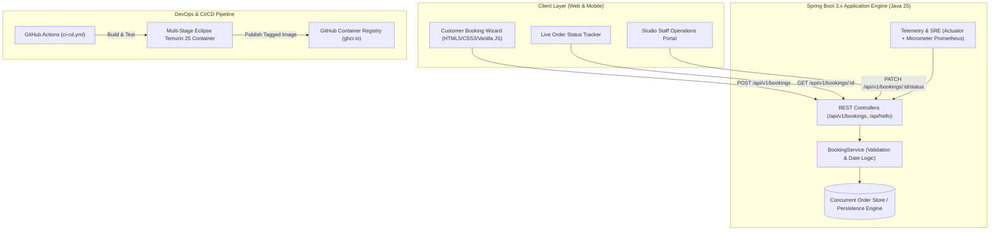

# 🥻 DrapeCraft — Saree Pre-Pleating & Box Folding Order Booking Platform

[](https://openjdk.org/projects/jdk/25/)
[](https://spring.io/projects/spring-boot)
[](https://www.docker.com/)
[](https://github.com/Ganishguru/saree-prepleating-system/actions)
[](https://github.com/Ganishguru/saree-prepleating-system/pkgs/container/saree-prepleating-system)
[](https://opensource.org/licenses/MIT)

> **Enterprise-grade, containerized Spring Boot web platform for boutique saree styling studios.** Features automated pre-pleating order booking, fabric-specific care calibration, emergency wedding (*Muhurtham*) deadline tracking, and an interactive studio management portal—engineered for 100% free-tier cloud deployment.

---

## 📖 Executive Summary

Saree draping for weddings, receptions, and festivals often requires 30–45 minutes of manual pleating and safety pins that risk tearing delicate silk and organza fibers. **DrapeCraft** provides a digital studio booking engine where customers can schedule professional steam pre-pleating, tailored waist/height folding, and travel box packaging.

### Key Highlights
- ⚡ **2-Minute Ready-to-Wear Drape**: Customers receive laser-aligned front pleats and pre-pinned shoulder pallu.
- 🛡️ **Zero Pin-Damage & Fabric Care**: Calibrated temperature and folding profiles for *Kanjivaram Silk, Banarasi, Soft Silk, Delicate Organza, Chiffon, and Cotton*.
- 🚨 **Muhurtham Deadline Guardian**: Automated priority queuing for events occurring in under 48 hours.
- 💰 **100% Free-Tier Architecture**: Built and deployed without recurring infrastructure costs ($0 budget).

---

## 🏗️ System Architecture



### Saree Order Lifecycle State Machine
```
   [DRAFT] 
      │ (Customer submits)
      ▼
 [CONFIRMED] ──> [SAREE_RECEIVED] ──> [IN_PROGRESS] ──> [READY_FOR_PICKUP] ──> [COMPLETED]
      │               │                    │
      └───────────────┴────────────────────┴──────> [CANCELLED]
```

---

## ✨ Features & Modules

### 1. Customer Booking Wizard
- **Service Package Selection**:
  - *Classic Pre-Pleating* (₹250): Steam ironed, 5–6 pleats, pinned pallu.
  - *Box Folding & Setting* (₹150): Compact travel suitcase packing.
  - *Bridal Deluxe Box Fold & Pleat* (₹450): Custom floor-height alignment & luxury box.
  - *Express Muhurtham (Same Day)* (₹600): Emergency turnaround within 6–12 hours.
- **Dynamic Surcharge Calculator**: Automatically applies fabric care surcharges (e.g., pure Kanjivaram silk zari vs. delicate organza) and doorstep courier logistics.
- **Measurements & Pleat Width**: Captures customer waist/height in inches and pleat preferences (Classic 5–6 wide pleats vs. Sleek 7–8 micro-pleats).

### 2. Live Order Tracker
- Customers enter their tracking code (e.g., `SPP-1001` or `SPP-2026-XXXX`).
- Visual 5-stage animated progress stepper displaying real-time studio handling stage.
- Real-time days remaining countdown alert for upcoming wedding muhurtham dates.

### 3. Studio Operations Portal (`🔐 Studio Portal`)
- Real-time management queue for boutique staff.
- Visual status transition dropdown to update orders instantly.
- Instant search by customer name, phone number, or order reference code.
- Urgent wedding filter highlighting orders with events in `< 48 hours`.

---

## 📁 Repository Structure

```
saree-prepleating-system/
├── .github/
│   └── workflows/
│       └── ci-cd.yml             # Automated Maven test, Docker build & GHCR publish
├── .mvn/wrapper/                 # Maven wrapper binaries & properties
├── src/
│   ├── main/
│   │   ├── java/com/ganish/myspringbootapp/
│   │   │   ├── MySpringbootAppApplication.java    # Spring Boot Main Entrypoint
│   │   │   ├── HelloController.java               # Health endpoint (/api/hello)
│   │   │   └── booking/                           # Saree Pre-Pleating Domain Module
│   │   │       ├── BookingController.java         # REST APIs (/api/v1/bookings)
│   │   │       ├── BookingOrder.java              # Order Domain Model
│   │   │       ├── BookingRequest.java            # Inbound Booking DTO
│   │   │       ├── BookingService.java            # Business Rules & Order Store
│   │   │       ├── FabricType.java                # Saree Fabric Taxonomy Enum
│   │   │       ├── OrderStatus.java               # Lifecycle State Machine Enum
│   │   │       └── StatusUpdateRequest.java       # Stage Transition DTO
│   │   └── resources/
│   │       ├── application.properties             # App configuration & Actuator metrics
│   │       └── static/                            # Saree Pre-Pleating Web Application
│   │           ├── index.html                     # Single Page Application
│   │           ├── styles.css                     # Boutique UI styling
│   │           └── app.js                         # Dynamic state & API connectivity
│   └── test/
│       └── java/com/ganish/myspringbootapp/
│           ├── MySpringbootAppApplicationTests.java
│           └── booking/
│               └── BookingServiceTest.java        # Unit & Validation Test Suite
├── Dockerfile                    # Multi-stage Eclipse Temurin Java 25 Container
├── pom.xml                       # Maven POM (Spring Boot 3/4 + Java 25)
└── README.md                     # Production-grade Project Documentation
```

---

## 🚀 REST API Reference

### 1. Create a New Saree Booking
- **Endpoint**: `POST /api/v1/bookings`
- **Request Payload**:
```json
{
  "customerName": "Priya Sundaram",
  "customerPhone": "9840123456",
  "customerEmail": "priya@example.com",
  "customerHeight": "Height 5'4\", Waist 30\"",
  "packageName": "Bridal Box Fold & Pleat",
  "fabricType": "KANJIVARAM_SILK",
  "sareeCount": 1,
  "pleatStyle": "CLASSIC",
  "sareeDescription": "Maroon & Gold Temple Border Kanjivaram",
  "eventDate": "2026-11-05",
  "pickupDate": "2026-11-04",
  "deliveryMode": "STUDIO_DROP_PICKUP",
  "specialInstructions": "Muhurtham at 7:00 AM; extra crisp pallu alignment.",
  "totalAmount": 500
}
```
- **Response**: `HTTP 201 Created` with generated `orderNumber` (e.g. `SPP-2026-4821`).

### 2. Live Order Tracking
- **Endpoint**: `GET /api/v1/bookings/{orderNumber}`
- **Example**: `GET /api/v1/bookings/SPP-1001`
- **Response**: `HTTP 200 OK`
```json
{
  "orderNumber": "SPP-1001",
  "customerName": "Ananya Ramachandran",
  "customerPhone": "9840123456",
  "packageName": "Bridal Box Fold & Pleat",
  "fabricType": "KANJIVARAM_SILK",
  "sareeCount": 1,
  "eventDate": "2026-10-30",
  "pickupDate": "2026-10-29",
  "status": "IN_PROGRESS",
  "totalAmount": 500
}
```

### 3. Update Order Stage (Staff Portal)
- **Endpoint**: `PATCH /api/v1/bookings/{orderNumber}/status`
- **Request Payload**:
```json
{
  "status": "READY_FOR_PICKUP"
}
```
- **Response**: `HTTP 200 OK`

### 4. Telemetry & Observability
- **Application Health**: `GET /actuator/health`
- **Prometheus Metrics**: `GET /actuator/prometheus`
- **Root API Greeting**: `GET /api/hello`

---

## 💻 Local Development & Testing

### Prerequisites
- **Java**: OpenJDK 25 (e.g., Eclipse Temurin)
- **Maven Wrapper**: `./mvnw` (Linux/macOS) or `.\mvnw.cmd` (Windows)
- **Docker**: Docker Desktop (optional for container runs)

### 1. Run Unit Tests
```bash
./mvnw clean test
```
*Expected: 5 tests run, 0 failures, BUILD SUCCESS.*

### 2. Start the Local Server
```bash
./mvnw spring-boot:run
```
*Open your browser at **`http://localhost:8080/`** to interact with the full web portal.*

---

## 🐳 Containerization & GHCR Deployment

### Multi-Stage Dockerfile
The project uses a secure, minimal multi-stage build:
1. **Builder Stage**: `eclipse-temurin:25-jdk` compiles source code and packages the fat JAR.
2. **Runtime Stage**: `eclipse-temurin:25-jre` runs as a dedicated non-root user (`UID 1000:1000`).

### Build & Run Locally
```bash
# Build Docker image
docker build -t drapecraft-saree-booking:latest .

# Run on port 8080
docker run -d -p 8080:8080 --name drapecraft-app drapecraft-saree-booking:latest

# Verify live health
curl http://localhost:8080/api/hello
```

### Pull and Run from GitHub Container Registry (GHCR)
Images are automatically published to GHCR on every push to `main`:
```bash
# Authenticate with Personal Access Token (PAT)
echo $GITHUB_PAT | docker login ghcr.io -u Ganishguru --password-stdin

# Pull and run the latest image
docker pull ghcr.io/ganishguru/saree-prepleating-system:latest
docker run -d -p 8080:8080 --name saree-prepleating-system ghcr.io/ganishguru/saree-prepleating-system:latest
```

---

## ⚡ Zero-Cost Cloud Deployment Guide ($0 / Free Forever)

This application is optimized to run completely within free tiers:

| Component | Recommended Provider | Free Tier Limits | Cost |
| :--- | :--- | :--- | :--- |
| **CI/CD Pipeline** | GitHub Actions | 2,000 runner minutes/month | **$0** |
| **Container Registry** | GitHub Container Registry (GHCR) | Unlimited public bandwidth & storage | **$0** |
| **Web Container Hosting** | [Render.com](https://render.com) or [Koyeb](https://koyeb.com) | 750 free instance hours/month | **$0** |
| **Serverless Database** | [Neon Postgres](https://neon.tech) / [Supabase](https://supabase.com) | 500 MB persistent storage | **$0** |

---

## 📄 License
This project is open-source and distributed under the [MIT License](LICENSE). Built by [Ganishguru](https://github.com/Ganishguru).
